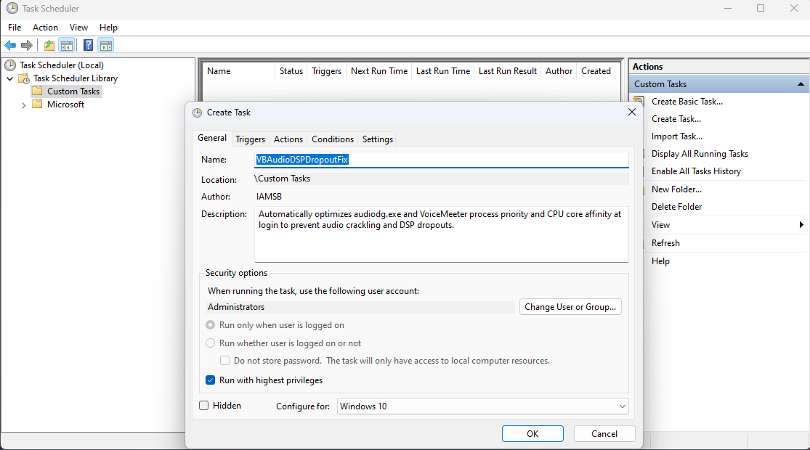
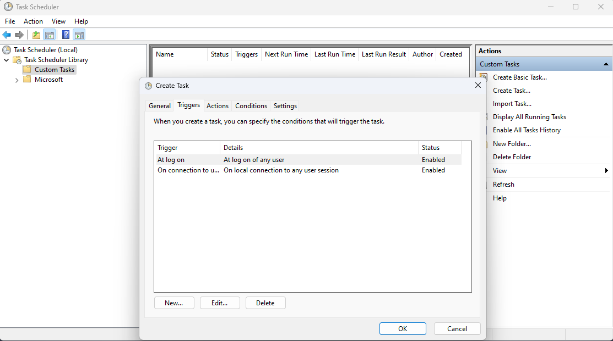
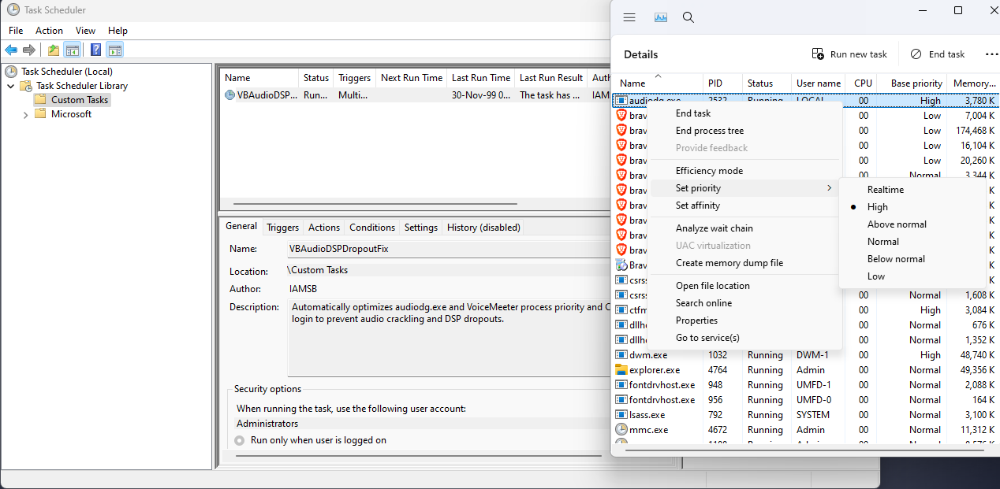
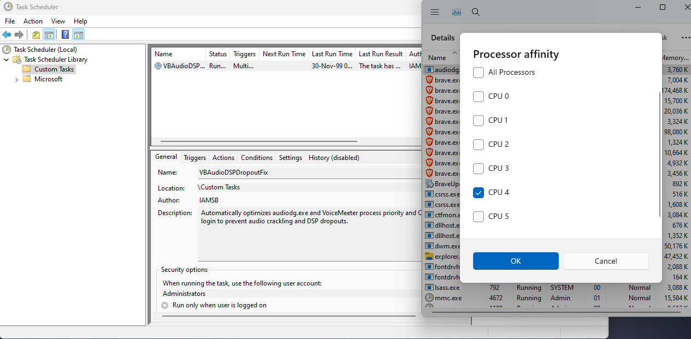
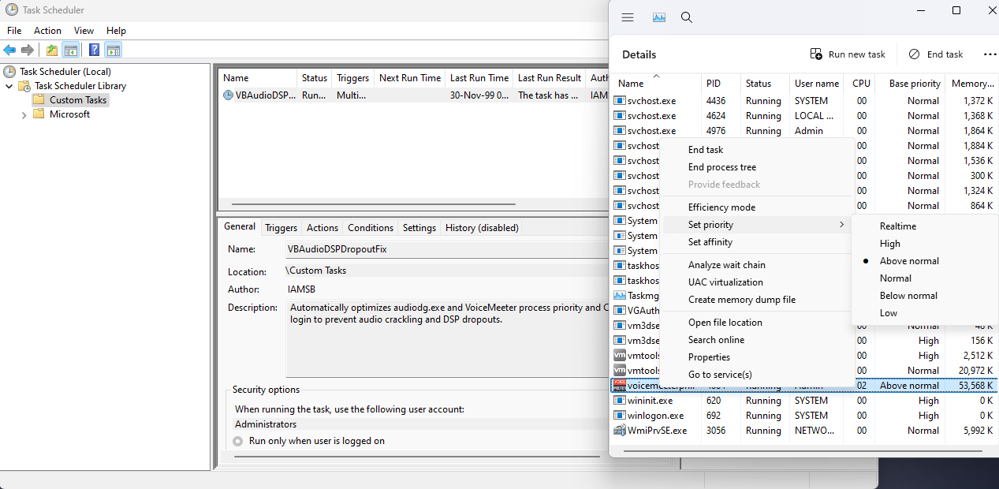

<a id="readme-top"></a>

<div align="center">

# 🎙️ VB-Audio VoiceMeeter DSP Dropout Fix

### Native C / Win32 audio-process optimization utility for Windows


-0078D4?style=for-the-badge&logo=windows&logoColor=white)
[](https://github.com/IAMSB-0/VBAudioDSPDropoutFix/releases/latest)
[](LICENSE)

**Reduce scheduling-related crackling, robotic audio, and DSP dropouts in VoiceMeeter setups.**

[**⬇️ Download Latest Release**](https://github.com/IAMSB-0/VBAudioDSPDropoutFix/releases/latest) · [**🛠️ Build from Source**](BUILDING.md) · [**📋 Changelog**](CHANGELOG.md) · [**🎬 Legacy Video**](https://www.youtube.com/watch?v=zkf1T5-Q7z4)

</div>

---

## 🌟 Overview

**VB-Audio VoiceMeeter DSP Dropout Fix** is a lightweight, native Windows utility written in **C using the Win32 API**. It improves audio-process scheduling stability by adjusting process priority and CPU core affinity for Windows Audio Device Graph Isolation (`audiodg.exe`) and supported VoiceMeeter editions.

Designed to run silently at user sign-in or console session connect via **Windows Task Scheduler**, the utility executes six timed optimization passes across a 118-second startup window and then exits cleanly—consuming zero background resources afterward.

> [!IMPORTANT]
> This utility addresses audio glitches caused by **CPU scheduling contention**. It cannot resolve crackling, robotic audio, or DSP dropouts caused by corrupted audio drivers, mismatched sample rates, undersized buffers, or hardware bottlenecks.

---

## ✨ Features

| Feature | Behavior |
| :--- | :--- |
| 🪶&nbsp;**Native&nbsp;Win32&nbsp;binary** | Pure C implementation; zero .NET, C++ runtime, or third-party dependencies |
| 🔇&nbsp;**Silent&nbsp;execution** | Compiled under the Windows GUI subsystem (`-mwindows`) with zero console flashes |
| 🎛️&nbsp;**All&nbsp;VoiceMeeter&nbsp;editions** | Automatically detects Standard, Banana, and Potato (`x86` and `x64` executables) |
| 🚀&nbsp;**VoiceMeeter&nbsp;priority** | Sets VoiceMeeter to `ABOVE_NORMAL_PRIORITY_CLASS` while preserving multi-core affinity |
| 🎧&nbsp;**Windows&nbsp;Audio&nbsp;priority** | Elevates `audiodg.exe` to `HIGH_PRIORITY_CLASS` via `SeDebugPrivilege` |
| 🧠&nbsp;**Smart&nbsp;CPU&nbsp;affinity** | Isolates `audiodg.exe` onto Logical Processor **4** (5th thread, mask `0x10`) when available, or safely falls back to the highest valid core on CPUs with **≤ 4 threads** |
| 🔁&nbsp;**Six&nbsp;startup&nbsp;passes** | Applies optimizations at **0s, 24s, 48s, 72s, 96s, and 118s** to catch delayed startups |
| 🔒&nbsp;**Single‑instance&nbsp;guard** | Global named mutex (`Global\VBAudioDSPDropoutFix_SingleInstance`) prevents overlapping runs |
| 📴&nbsp;**Zero&nbsp;idle&nbsp;footprint** | Terminates completely once the 118-second startup sequence finishes |
| 🛡️&nbsp;**Hardened&nbsp;release&nbsp;build** | Compiled with PIE, ASLR (`--dynamicbase`), High-Entropy 64-bit VA, and DEP (`--nxcompat`) |

---

## 🖼️ Screenshots

### 📸 1. Task Scheduler — Imported Task

*Imported scheduled task configured to run silently with highest privileges.*

### 📸 2. Task Scheduler — Triggers

*Configured triggers for user logon and console session connection.*

### 📸 3. `audiodg.exe` — Process Priority

*Windows Audio Device Graph Isolation elevated to **High** priority.*

### 📸 4. `audiodg.exe` — CPU Affinity

*`audiodg.exe` isolated onto Logical CPU 4 away from Core 0 interrupt traffic.*

### 📸 5. VoiceMeeter — Process Priority

*Supported VoiceMeeter edition elevated to **Above normal** priority.*

---

## 🎬 Video Demonstration — Legacy Version

<div align="center">
  <a href="https://www.youtube.com/watch?v=zkf1T5-Q7z4">
    
  </a>
  <br />
  <a href="https://www.youtube.com/watch?v=zkf1T5-Q7z4"><strong>▶️ Watch on YouTube</strong></a>
</div>

> [!NOTE]
> This video demonstrates the **original batch-based prototype**. The current release is a **from-scratch native C / Win32 rewrite** with lower overhead, safer CPU core fallback, and silent background execution. The video is kept for background context on the problem being solved.

---

## 📥 Installation — Recommended Task Scheduler Setup

### 1. Download the release assets

Open [**GitHub Releases**](https://github.com/IAMSB-0/VBAudioDSPDropoutFix/releases/latest) and download both files:

- `VBAudioDSPDropoutFix.exe` — Compiled 64-bit Windows executable
- `VBAudioDSPDropoutFix.xml` — Preconfigured Task Scheduler template

*(Tip: If Windows marks the downloaded `.exe` from your browser, right-click `VBAudioDSPDropoutFix.exe` → **Properties** → check **Unblock** → **OK**.)*

### 2. Place the executable in the installation directory

Copy `VBAudioDSPDropoutFix.exe` to:

```text
C:\Program Files (x86)\VB\VBAudioDSPDropoutFix.exe
```

Create the `VB` folder if it does not already exist (Administrator permission is required to copy files into `Program Files (x86)`).

> [!TIP]
> **Custom path:** If you store the executable elsewhere, update **Actions → Program/script** inside Task Scheduler after importing the XML.

### 3. Import the scheduled task

1. Press <kbd>Win</kbd> + <kbd>R</kbd>, type `taskschd.msc`, and press <kbd>Enter</kbd>.
2. In **Task Scheduler**, click **Import Task…** in the right-hand Actions pane.
3. Select `VBAudioDSPDropoutFix.xml`.
4. Review the **General**, **Triggers**, and **Actions** tabs to confirm the executable path matches your setup.
5. Click **OK** to save the task (Administrator approval may be requested).

The template runs under the built-in **Administrators** group (`S-1-5-32-544`) with **Run with highest privileges** (`HighestAvailable`), triggers at **user logon** and **local console session connect**, allows execution on battery power, ignores overlapping new instances, and enforces a 5-minute safety timeout (`PT5M`).

### 4. Test and verify

1. Right-click **VBAudioDSPDropoutFix** in Task Scheduler and click **Run**.
2. Open **Task Manager → Details** while audio and VoiceMeeter are active:
   - Right-click `audiodg.exe` → **Set priority** → verify **High**.
   - Right-click `audiodg.exe` → **Set affinity** → verify **CPU 4** (or highest available core on ≤ 4-thread CPUs).
   - Right-click your VoiceMeeter process → **Set priority** → verify **Above normal**.

### 🗑️ Uninstallation

1. Open **Task Scheduler** (`taskschd.msc`), right-click **VBAudioDSPDropoutFix**, and select **Delete**.
2. Delete `C:\Program Files (x86)\VB\VBAudioDSPDropoutFix.exe`.
3. Reboot Windows (or restart Windows Audio / VoiceMeeter) to restore default OS process priorities and CPU affinity.

---

## 🎛️ Supported VoiceMeeter Editions

| Edition | Recognized Executables |
| :--- | :--- |
| **VoiceMeeter Standard** | `voicemeeter.exe`, `voicemeeter_x64.exe` |
| **VoiceMeeter Banana** | `voicemeeterpro.exe`, `voicemeeterpro_x64.exe` |
| **VoiceMeeter Potato** | `voicemeeter8.exe`, `voicemeeter8x64.exe` |

---

## ⚙️ How It Works

```text
Windows Logon / Console Session Connect
                   │
                   ▼
        Task Scheduler starts EXE
                   │
                   ▼
      Acquire Global Single-Instance Mutex
                   │
                   ▼
         Enable SeDebugPrivilege
                   │
                   ▼
        Snapshot Running Processes
                   │
                   ├── audiodg.exe
                   │     ├── Priority  → HIGH_PRIORITY_CLASS
                   │     └── Affinity  → Logical Core 4 (or highest valid core)
                   │
                   └── VoiceMeeter (Standard / Banana / Potato)
                         └── Priority  → ABOVE_NORMAL_PRIORITY_CLASS
                   │
                   ▼
      Repeat across 6 passes (118s total)
                   │
                   ▼
        Release Mutex & Exit Cleanly
```

---

## 🛠️ Build from Source

**Tested Toolchain:** MSYS2 **UCRT64** (`gcc` 16.1.0, GNU `windres` 2.46.1) on Windows 10/11 x64.

### Option A: Visual Studio Code

1. Ensure the MSYS2 UCRT64 `bin` folder is added to your Windows `PATH` (and the VS Code **C/C++** extension is installed).
2. Open the repository root folder in **VS Code**.
3. Press <kbd>Ctrl</kbd> + <kbd>Shift</kbd> + <kbd>B</kbd> to run **`📦 Build : Secure Release`**.
4. Retrieve the compiled binary at `build/VBAudioDSPDropoutFix.exe`.

### Option B: PowerShell (Manual CLI)

Run from the repository root:

```powershell
New-Item -ItemType Directory -Force -Path "build" | Out-Null
Push-Location "src"; windres -c 65001 resources.rc -o "../build/resources.o"; Pop-Location
gcc -fdiagnostics-color=always -Wall -Wextra -O2 -s -fPIE src/main.c build/resources.o -o build/VBAudioDSPDropoutFix.exe -mwindows -pie -Wl,--dynamicbase -Wl,--nxcompat -Wl,--high-entropy-va
Remove-Item -LiteralPath "build/resources.o" -ErrorAction SilentlyContinue
```

See **[BUILDING.md](BUILDING.md)** for full compiler prerequisites, security flag breakdowns, and build troubleshooting.

---

## 🧩 Troubleshooting

- **Nothing appears when running the `.exe`:** Expected behavior. Compiled with `-mwindows`, it runs invisibly in the background with zero UI or console windows.
- **Priority or affinity did not change:** Ensure the task runs with **Highest Privileges** (Administrator). Unprivileged execution cannot enable `SeDebugPrivilege` or modify `audiodg.exe`.
- **Task Scheduler cannot find the file:** Verify **Task Scheduler → Properties → Actions** points to the exact path where `VBAudioDSPDropoutFix.exe` is saved.
- **VoiceMeeter launched more than 2 minutes after login:** Processes started after the 118-second window finishes will not be modified until the task runs again (manually or on next console session connect / logon).
- **Audio still crackles:** Verify WDM/KS/ASIO buffer sizes and uniform sample rates (e.g., `48000 Hz` across Windows Sound settings and VoiceMeeter Hardware Out).

---

## 🔐 File Integrity

Each GitHub Release publishes SHA-256 checksums for its downloadable assets. Verify your downloaded files in PowerShell before importing:

```powershell
Get-FileHash .\VBAudioDSPDropoutFix.exe, .\VBAudioDSPDropoutFix.xml -Algorithm SHA256
```

---

## 📂 Repository Structure

```text
VBAudioDSPDropoutFix/
├── .vscode/
│   └── tasks.json
├── assets/
│   ├── icons/
│   │   └── VB-Audio.ico
│   └── screenshots/
│       ├── 01-task-scheduler.png
│       ├── 02-task-triggers.png
│       ├── 03-audiodg-priority.png
│       ├── 04-audiodg-affinity.png
│       └── 05-voicemeeter-priority.png
├── src/
│   ├── main.c
│   └── resources.rc
├── .gitignore
├── BUILDING.md
├── CHANGELOG.md
├── LICENSE
└── README.md
```

---

## 📜 License & Disclaimer

Distributed under the **[MIT License](LICENSE)**. Copyright © 2022–2026 IAMSB.

**VB-Audio** and **VoiceMeeter** are trademarks of VB-Audio Software. This project is an independent third-party utility and is neither affiliated with nor endorsed by VB-Audio Software.

<div align="center">

**🎙️ Focused Windows audio-process scheduling without permanent background bloat.**

[⬆ Back to top](#readme-top)

</div>
